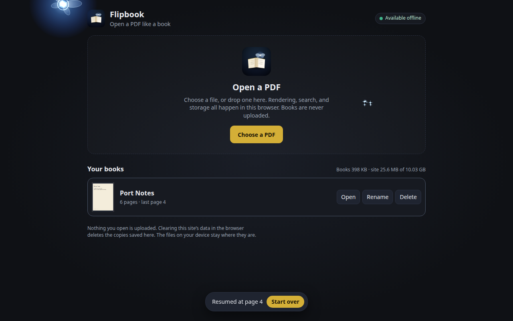

# Flipbook

Open a PDF like a book. Turn the pages.

**[Open Flipbook](https://gabe-torres.github.io/flipbook/)**



Pick a PDF from your device, or drop one on the page. Flipbook draws the pages in the browser and keeps them there. Search, bookmarks, and the last page you were on stay with that book. Nothing is uploaded.

A scanned PDF with no text layer can run English text recognition, also on this device. The first time, it loads the recognition files that ship with the app, so it still works after you go offline.

## How to read

On a computer:

- Drag a corner to turn a page, or use the arrows. Home and End jump to the ends.
- `/` searches. Enter jumps to the next hit. Quotes around a phrase look for those exact words.
- `B` bookmarks the page. You can give it a label. `M` opens the list. Bookmarked pages get a red ribbon.
- `C` opens the contents. If the PDF has an outline, those chapters are listed, including nested ones, and a click turns to that page. A PDF with no outline says so. You can add your own chapters, with a title and a page number. Those stay in this browser with the book.
- `H` opens highlights and notes. Highlight drags a rectangle on the page. Note places a sticky note. Both work on a scanned page. Read mode is for turning pages. Highlights and notes stay in this browser and are not written into the PDF.
- `Z` or a double-click zooms. `T` opens the thumbnails. `F` is full screen. `G` jumps to a page number.
- `N` changes the cursor: fairy, a small glow, or the normal cursor. It follows the mouse, stays off a touch screen, and calms down if you have Reduce Motion on. In the menu, a click can play a short sound. You can swap in your own audio file. That file stays on this device.
- The menu also sets the theme: Light, Dark, or System. System follows the device. The choice stays in this browser and covers the library and every saved book. The pages themselves are not recolored.

On a phone:

- Swipe to turn, or use the buttons along the bottom. Pinch to zoom.
- Pages, search, bookmarks, contents, and notes open as full-screen sheets. Highlight and Note pause swipes until you tap Done.
- The fairy stays hidden. There is no pointer for her to follow.

Wide windows show two pages. A phone shows one. The menu can force either.

The app remembers the last page and those settings for each book. When you come back it says "Resumed at page N".

## Offline

Open the link once while you are online, and wait until the corner says "Available offline". After that the app itself opens with the network off. Books you already imported are in this browser, so they open too.

On a phone, use the browser, not a texted file. Then Share, Add to Home Screen. The icon is an open book with a small light. Open that icon once while you are still online.

Your books are not on the server. Clearing this site's data in the browser deletes the copies saved there. The files on your device stay where they are.

If a new version is published, an open copy says "Update available".

## Develop

GitHub Pages serves `docs/index.html` from `main`, same as [Flit](https://github.com/Gabe-Torres/flit).

From this folder:

```bash
python3 -m http.server 8000 --directory docs
```

Open [http://localhost:8000/](http://localhost:8000/).

After you change a file in `docs/`:

```bash
python3 tools/build_sw.py
```

That writes a new cache version into `docs/sw.js`. The browser checks that file and offers the update.

```bash
npm install
npm test
```

The test builds two small original PDFs, one with text and one made only of pictures, and opens them in headless Chrome. It checks import, search, bookmarks, an offline reload, and the phone layout.
